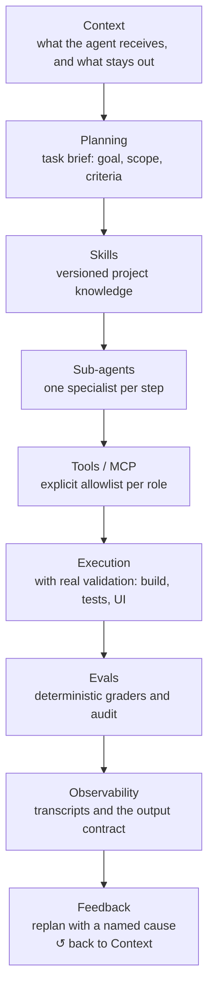

# Harness Engineering

> A structure for operating AI agents in a way that is **predictable, auditable, and correctable** — what
> separates "asking the AI" from "operating a system of agents."

This repository documents a set of patterns for coordinating multiple LLM agents in a real software project.
It is not a framework to install; it is a **mental model with reference artifacts**: contracts, conventions, and
checks you adapt to your own harness (Claude Code, Cursor, a custom orchestrator).

It came from practice, not theory. The patterns here were extracted from a production monorepo (.NET + Next.js)
with 8 specialized agents, 6 versioned skills, and evals running in CI.

---

## The problem

An LLM is not a deterministic `input → output` function. It is more honest to model it like this:

```text
input + context + version + model + parameters  →  distribution of possible outputs
```

When you chain several agents, three things degrade silently:

1. **Context grows without bound** — each step inherits everything that came before, and the window degrades.
2. **Confidence is invented** — an agent says "done" without having validated, and the next one trusts it.
3. **Regression is invisible** — an edited prompt breaks a behavior and no test complains.

Harness Engineering is the set of disciplines that closes these three gaps.

---

## The cycle



---

## The principles

| Principle | What it means | Document |
| --- | --- | --- |
| **Explicit source of truth** | "What the system does" (execution, code) is kept separate from "what it should do" (decisions, specs). Divergence is a finding, not something to resolve silently. | [source-of-truth.md](docs/source-of-truth.md) |
| **Output contract** | Every agent returns a structured block the orchestrator reads by machine, without interpreting prose. | [output-contract.md](docs/output-contract.md) |
| **Context budget** | Each step receives only what changes its decision. Paths, never pasted content. | [context-budget.md](docs/context-budget.md) |
| **Orchestration with a gate** | Plan → retrieve → execute → synthesize → verify → decide. Retrying a step requires naming the cause of failure. | [orchestration.md](docs/orchestration.md) |
| **Independent verifier** | The reviewer does not receive the executor's reasoning — otherwise it validates the narrative, not the artifact. | [orchestration.md](docs/orchestration.md) |
| **Evals enforce written rules** | An eval is never a second source of norms. Every violation cites the document the rule comes from. | [evals/](evals/) |

---

## Layout

```
docs/        the principles, one per file
examples/    one reference agent and one skill, generic
evals/       a dependency-free static check you adapt
```

---

## A real case

Before building a full evaluation framework, the deterministic graders were run offline against **89 real
executions** of the agents, already recorded by the harness. The result cut ~80% of the planned framework:

- The expensive-to-verify rules were **already being followed** — zero improper writes by read-only agents,
  zero invented evidence across 115 citations, zero `confidence: HIGH` without executed validation.
- The real failures were about **form and hygiene**: 6 of 38 responses in the wrong format the orchestrator
  couldn't read, and 22 delegations with a credential in plain text.

The lesson became a principle of this repository: **measure with the data you already have before building
infrastructure.** The tool only enforces rules that are already written; the rest is deferred with a return trigger.

---

## License

[MIT](LICENSE).
